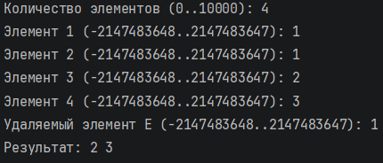
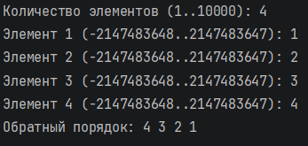
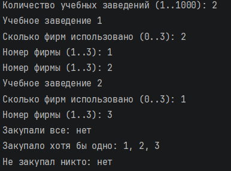
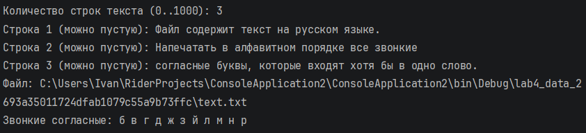
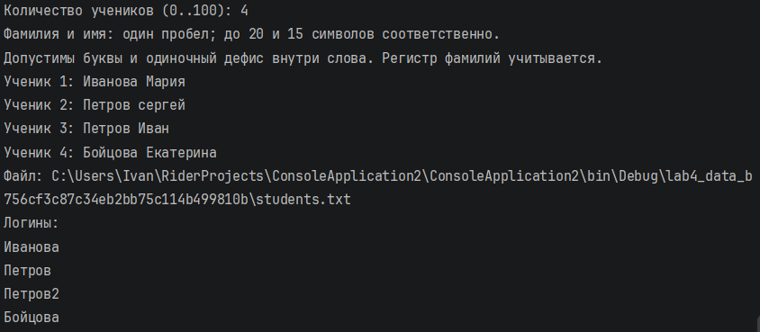
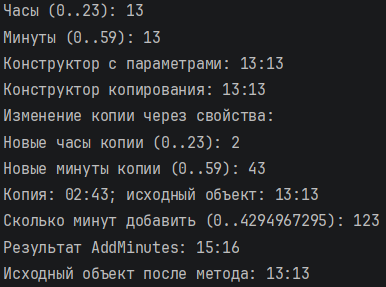
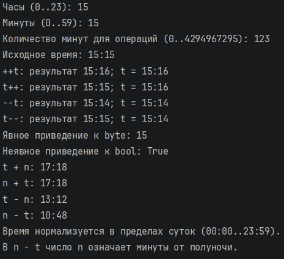

Гладышев Иван, ЛА-3

# Лабораторная работа №4

## Задание 1

### Задача 1

#### Текст задачи

Составить программу, которая удаляет из списка L все элементы E, если такие есть. Использовать List.

#### Алгоритм решения

1. Ввести количество элементов, сами целые числа и значение E.

2. Просмотреть список слева направо. Числа, не равные E, последовательно записывать в начало этого же списка.

3. После просмотра удалить оставшийся хвост списка. Порядок сохранённых чисел не меняется.

4. Вывести полученный список. Если он пуст, сообщить об этом.

#### Тестирование

## Задание 2

### Задача 1

#### Текст задачи

Напечатать в обратном порядке элементы непустого списка L.

#### Алгоритм решения

1. Ввести положительное количество элементов и добавить числа в конец связного списка.

2. Перейти к последнему узлу списка.

3. Записать его значение в результат и перейти к предыдущему узлу.

4. Повторять, пока узлы не закончатся, затем вывести результат. Сам список не изменяется.

#### Тестирование

## Задание 3

### Задача 1

#### Текст задачи

В городе имеется n общеобразовательных учебных заведений, которые могут закупать компьютерную технику и оргтехнику. Есть перечень компьютерных фирм, где может производиться закупка. Ответить на следующие вопросы: 1) в каких фирмах закупка производилась каждым из заведений? 2) в каких фирмах закупка производилась хотя бы одним из заведений? 3) в каких фирмах ни одно из заведений не закупало компьютеры?

#### Алгоритм решения

1. Ввести перечень фирм без повторов и положительное количество учебных заведений.

2. Для каждого заведения выбрать фирмы по номерам. Повторный выбор одной фирмы не принимать.

3. Для ответа «все» оставить фирмы, которые есть в списке закупок каждого заведения. Для ответа «хотя бы одно» собрать все выбранные фирмы.

4. Из общего перечня убрать фирмы, где уже были закупки. Оставшиеся фирмы никто не использовал.

5. Вывести три результата в порядке исходного перечня.

#### Тестирование

## Задание 4

### Задача 1

#### Текст задачи

Файл содержит текст на русском языке. Напечатать в алфавитном порядке все звонкие согласные буквы, которые входят хотя бы в одно слово.

#### Алгоритм решения

1. Ввести строки текста с клавиатуры. Отдельным методом FillTextFile сохранить их в файл UTF-8.

2. Открыть файл и читать символы по одному. Большие буквы переводить в маленькие.

3. Если буква входит в набор «бвгджзйлмнр», добавить её в множество найденных букв. Повторы множество не сохраняет.

4. Пройти по этому набору в алфавитном порядке и вывести найденные буквы. Если их нет, вывести «нет».

#### Тестирование

## Задание 5

### Задача 1

#### Текст задачи

На вход программы подаются фамилии и имена учеников. Известно, что общее количество учеников не превосходит 100. В первой строке вводится количество учеников, принимавших участие в соревнованиях, N. Далее следуют N строк, имеющих следующий формат: Здесь – строка, состоящая не более чем из 20 символов; – строка, состоящая не более чем из 15 символов. При этом и разделены одним пробелом. Примеры входных строк: Иванова Мария Петров Сергей Требуется написать программу, которая формирует и печатает уникальный логин для каждого ученика по следующему правилу: если фамилия встречается первый раз, то логин – это данная фамилия, если фамилия встречается второй раз, то логин – это фамилия, в конец которой приписывается число 2 и т.д. Например, для входной последовательности: Иванова Мария Петров Сергей Бойцова Екатерина Петров Иван Иванова Наташа будут сформированы следующие логины: Иванова Петров Бойцова Петров2 Иванова2

#### Алгоритм решения

1. Ввести N и данные учеников. Проверить длины и формат строк. Метод FillStudentsFile записывает N и учеников в текстовый файл.

2. При чтении файла создать словарь: фамилия — количество её появлений.

3. Для каждого ученика найти счётчик фамилии, увеличить его на один и сохранить обратно.

4. При первом появлении использовать фамилию без числа. При повторном добавить счётчик к фамилии.

5. Вывести логины в том же порядке, что и ученики в файле.

#### Тестирование

## Задание 6

### Задача 1

#### Текст задачи

Название класса: Time. Поля: byte hours byte minutes. Методы: Добавление произвольного количества минут (uint) к объекту типа Time. Результат должен быть типа Time.

#### Алгоритм решения

1. Хранить часы и минуты в закрытых полях \_hours и \_minutes. Свойства Hours и Minutes проверяют диапазоны 0–23 и 0–59.

2. Сделать три конструктора: без параметров, с часами и минутами, а также конструктор копирования.

3. В AddMinutes перевести исходное время в минуты и прибавить введённое число. Для вычисления использовать long, чтобы избежать переполнения.

4. Оставить остаток от деления на 1440, затем получить часы делением на 60, минуты — остатком от деления на 60.

5. Вернуть новый объект. Через ToString() вывести время в формате ЧЧ:ММ.

#### Тестирование

## Задание 7

### Задача 1

#### Текст задачи

Название класса: Time. Методы: Унарные операции: ++ добавление минуты к объекту типа Time -- вычитание минуты из объекта типа Time Операции приведения типа: byte (явная) – результатом является количество часов (минуты отбрасываются); bool (неявная) – результатом является true, если часы и минуты не равны нулю, и falseв противном случае. Бинарные операции: + Time t, беззнаковое целое число (минуты) (лево- и правосторонние операции). Результат должен быть типа Time. – Time t, беззнаковое целое число (минуты) (лево- и правосторонние операции).Результат должен быть типа Time.

#### Алгоритм решения

1. Для ++ и -- создать новое время с изменением на одну минуту. Это сохраняет правильное различие между префиксной и постфиксной записью.

2. При приведении к byte вернуть часы. При приведении к bool проверить, что оба поля не равны нулю.

3. Сложение t + n и n + t выполнить через AddMinutes.

4. Для t - n вычесть минуты из времени; для n - t вычесть время в минутах из числа n.

5. Привести результат к диапазону суток. Если остаток отрицательный, прибавить 1440. Проверить все операции через меню.

#### Тестирование

